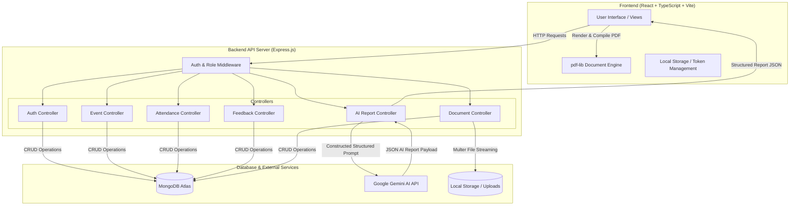

# Academic Event Hub - Complete Project Documentation

**Institution:** Sona College of Technology, Salem  
**Department:** Department of Information Technology  
**Project Title:** Academic Event Hub - Full-Stack Event Management & AI-Powered Reporting System  
**Document Version:** 1.0.0  
**Date:** September 13, 2026  
**System Status:** ✅ Production Ready  

---

## Table of Contents
1. [Executive Summary & Project Scope](#1-executive-summary--project-scope)
2. [Software Requirements Specification (SRS)](#2-software-requirements-specification-srs)
3. [System Architecture & Design](#3-system-architecture--design)
4. [Database Schemas & Data Models](#4-database-schemas--data-models)
5. [API & Interface Specifications](#5-api--interface-specifications)
6. [Core Modules & Technical Walkthrough](#6-core-modules--technical-walkthrough)
   - [6.1 Authentication & RBAC Engine](#61-authentication--rbac-engine)
   - [6.2 Event Lifecycle Management](#62-event-lifecycle-management)
   - [6.3 Student Attendance System (QR & OD)](#63-student-attendance-system-qr--od)
   - [6.4 Dynamic Feedback Engine](#64-dynamic-feedback-engine)
   - [6.5 AI Analytics & Executive Summarizer](#65-ai-analytics--executive-summarizer)
   - [6.6 PDF Generation & Document Merging System](#66-pdf-generation--document-merging-system)
   - [6.7 Analytics & Semester Excel Export](#67-analytics--semester-excel-export)
7. [Installation & Deployment Guide](#7-installation--deployment-guide)
8. [Security & Verification Standards](#8-security--verification-standards)
9. [Future Enhancements](#9-future-enhancements)

---

## 1. Executive Summary & Project Scope

### 1.1 Overview
**Academic Event Hub** is an enterprise-grade, full-stack web application designed for academic institutions to digitize, streamline, and automate the entire lifecycle of academic events—including workshops, symposiums, guest lectures, national/international conferences, and faculty development programs (FDPs).

The platform bridges the communication gap between institutional administrators (HODs, Deans), event coordinators, faculty members, and students by consolidating event scheduling, attendance tracking, feedback collection, AI-based analytics, and official report generation into a unified digital workspace.

### 1.2 Problem Statement
Traditional academic event management in colleges suffers from several critical bottlenecks:
* **Fragmented Workflows:** Event approvals, venue bookings, circular distribution, and attendance tracking are conducted across disparate paper forms, spreadsheets, and emails.
* **Manual Attendance & Verification:** Paper-based roll calls lead to lost records, errors in On-Duty (OD) allocations, and slow reconciliation.
* **Inefficient Report Compilation:** Creating formal academic event reports with feedback analytics, photographs, circulars, and attendance sheets requires hours of manual word processing and document assembly.
* **Lack of Data Intelligence:** Institution leaders lack real-time visibility into student participation trends, department event metrics, and quantitative student feedback sentiment.

### 1.3 System Objectives
1. **Centralize Event Governance:** Provide role-tailored dashboards for Admins, HODs, Coordinators, Faculty, and Students.
2. **Automate Attendance Tracking:** Enable fast digital attendance marking with support for Present (P), Absent (A), and On-Duty (OD) statuses.
3. **AI-Driven Report Generation:** Leverage Google Gemini 2.0 / OpenAI LLM services to generate structured, formal academic event reports automatically from raw attendance, feedback, and document attachments.
4. **Data Snapshot PDF Generation:** Implement zero-inconsistency, client-side PDF document compilation with customized header branding, dynamic text wrapping, and image/document stitching (`pdf-lib`).
5. **Cross-Departmental Collaboration:** Support joint events managed by multiple departments (e.g., Information Technology and Artificial Intelligence & Data Science).

---

## 2. Software Requirements Specification (SRS)

### 2.1 Functional Requirements (FR)

| Requirement ID | Module | Description | Target User Roles |
|---|---|---|---|
| **FR-01** | Authentication | Secure login & registration using JWT tokens and BCrypt password hashing. | All Roles |
| **FR-02** | User Management | Admin capabilities to add, edit, activate/deactivate users, and assign roles. | Admin, HOD |
| **FR-03** | Event Management | Create, edit, cancel, and publish events with custom tags, mode (online/offline), budget, resource persons, and multi-department tagging. | Coordinator, HOD, Admin |
| **FR-04** | Department Hub | Specialized dashboards for IT and AI & DS departments showing active events, key metrics, and joint events. | HOD, Faculty |
| **FR-05** | Student Portal | Student dashboard for viewing eligible upcoming events, registering, viewing event details, and submitting feedback. | Student |
| **FR-06** | Attendance Marking | Manual and QR-assisted student attendance tracking with Instant OD status marking and attendance rate percentage calculation. | Coordinator, Faculty |
| **FR-07** | Feedback Form Builder | Custom dynamic question builder supporting rating scales (1-5 stars), text responses, and multiple choice options. | Coordinator |
| **FR-08** | AI Executive Report | AI-assisted generation of comprehensive academic summaries evaluating feedback sentiment, student engagement, strengths, and recommendations. | Coordinator, HOD, Admin |
| **FR-09** | PDF Report Engine | Client-side snapshot PDF generation and multi-document stitching (compiling circulars, photos, attendance logs into one PDF file). | Coordinator, Admin |
| **FR-10** | Analytics & Export | Semester-wise event analytics, interactive charts, and Excel dataset exports (`.xlsx`). | Admin, HOD |

### 2.2 Non-Functional Requirements (NFR)

* **Performance:** API response times < 200ms for database queries; client-side PDF generation completes within 1 second.
* **Security:** Role-Based Access Control (RBAC) enforced via HTTP Authorization headers (Bearer JWT Token); password minimum complexity enforcement; CORS protection.
* **Reliability:** Data snapshot mechanism guarantees zero report state corruption if live database records are modified during generation.
* **Usability & Design:** Modern UI inspired by modern design principles featuring dark mode, custom color accents (indigo, emerald, violet), glassmorphism, responsive grid layouts, and high-contrast support.
* **Scalability:** Statistically scalable MongoDB schemas indexed on `eventId`, `department`, `academicYear`, and `userRole`.

### 2.3 User Roles & Access Matrix

| Feature / Action | Admin | HOD | Coordinator | Faculty | Student |
|---|:---:|:---:|:---:|:---:|:---:|
| System Dashboard & Global Analytics | ✅ | ✅ | ❌ | ❌ | ❌ |
| Departmental Dashboard | ✅ | ✅ | ✅ | ✅ | ❌ |
| User Provisioning & Password Resets | ✅ | ⚡ (Dept) | ❌ | ❌ | ❌ |
| Event Creation & Publishing | ✅ | ✅ | ✅ | ❌ | ❌ |
| Attendance Tracking & OD Marking | ✅ | ✅ | ✅ | ✅ | ❌ |
| Student Event Registration | ❌ | ❌ | ❌ | ❌ | ✅ |
| Feedback Submission | ❌ | ❌ | ❌ | ❌ | ✅ |
| AI Report Generation & PDF Export | ✅ | ✅ | ✅ | ⚡ (View) | ❌ |
| System Theme & Settings Customization | ✅ | ✅ | ✅ | ✅ | ❌ |

*(Legend: ✅ Full Access | ⚡ Partial / Department-Restricted | ❌ No Access)*

---

## 3. System Architecture & Design

### 3.1 Technological Stack

```
┌────────────────────────────────────────────────────────────────────────┐
│                          FRONTEND (CLIENT LAYER)                       │
│  React 18  │  TypeScript  │  Vite  │  Tailwind CSS  │  pdf-lib  │  Lucide │
└───────────────────────────────────┬────────────────────────────────────┘
                                    │ HTTP REST API (JSON / JWT)
┌───────────────────────────────────▼────────────────────────────────────┐
│                          BACKEND (SERVER LAYER)                        │
│  Node.js (Express v5) │ JWT Auth │ BCryptJS │ Multer │ Nodemailer        │
└─────────┬─────────────────────────┬──────────────────────────┬─────────┘
          │                         │                          │
┌─────────▼───────────┐    ┌────────▼────────────┐   ┌─────────▼─────────┐
│     DATABASE        │    │    AI LLM ENGINE    │   │ FILE STORAGE      │
│  MongoDB (Mongoose) │    │ Google Gemini 2.0 / │   │ Local Disk /      │
│  Atlas Cloud / Local│    │ OpenAI GPT-4 API    │   │ Uploads Directory │
└─────────────────────┘    └─────────────────────┘   └───────────────────┘
```

### 3.2 System Architecture Diagram



---

## 4. Database Schemas & Data Models

The system is built on 9 core Mongoose models:

### 4.1 User Schema (`backend/models/User.js`)
```javascript
{
  name: { type: String, required: true },
  email: { type: String, required: true, unique: true },
  password: { type: String, required: true },
  role: { type: String, enum: ['admin', 'hod', 'coordinator', 'faculty', 'student'], default: 'faculty' },
  department: { type: String, required: true },
  registerNumber: { type: String }, // For Students
  employeeId: { type: String },     // For Staff
  phone: { type: String },
  designation: { type: String },
  avatarColor: { type: String, default: 'indigo' },
  active: { type: Boolean, default: true }
}
```

### 4.2 Event Schema (`backend/models/Event.js`)
```javascript
{
  id: { type: String, required: true, unique: true }, // e.g. "EVT-001"
  name: { type: String, required: true },
  type: { type: String, required: true }, // Workshop, Guest Lecture, Symposium, etc.
  department: { type: String, required: true },
  jointDepartments: [{ type: String }],
  academicYear: { type: String, required: true }, // e.g. "2026-2027"
  date: { type: Date, required: true },
  dateTo: { type: Date },
  startTime: { type: String },
  endTime: { type: String },
  venue: { type: String, required: true },
  mode: { type: String, enum: ['Offline', 'Online', 'Hybrid'], default: 'Offline' },
  coordinator: { type: String, required: true },
  additionalCoordinators: [{ type: String }],
  assignedFaculty: [{ type: String }],
  targetStudents: { type: String },
  expectedParticipants: { type: Number, default: 0 },
  actualParticipants: { type: Number, default: 0 },
  sponsoredBy: { type: String },
  budget: { type: Number, default: 0 },
  resourcePerson: {
    name: { type: String },
    designation: { type: String },
    organization: { type: String }
  },
  objective: { type: String },
  description: { type: String },
  status: { type: String, enum: ['Draft', 'Scheduled', 'Ongoing', 'Completed', 'Cancelled'], default: 'Scheduled' },
  feedbackScore: { type: Number, default: 0.0 }
}
```

### 4.3 Attendance Schema (`backend/models/Attendance.js`)
```javascript
{
  eventId: { type: String, required: true, index: true },
  studentId: { type: mongoose.Schema.Types.ObjectId, ref: 'User' },
  studentName: { type: String, required: true },
  registerNumber: { type: String, required: true },
  department: { type: String, required: true },
  section: { type: String },
  status: { type: String, enum: ['P', 'A', 'OD'], default: 'P' }, // Present, Absent, On-Duty
  verificationMethod: { type: String, enum: ['Manual', 'QR', 'Self'], default: 'Manual' },
  timestamp: { type: Date, default: Date.now }
}
```

### 4.4 FeedbackForm & Feedback Schemas (`backend/models/FeedbackForm.js`, `Feedback.js`)
```javascript
// FeedbackForm Schema
{
  eventId: { type: String, required: true, unique: true },
  title: { type: String },
  questions: [{
    id: { type: String, required: true },
    text: { type: String, required: true },
    type: { type: String, enum: ['rating', 'text', 'choice'], required: true },
    options: [{ type: String }]
  }],
  isActive: { type: Boolean, default: true }
}

// Feedback Response Schema
{
  eventId: { type: String, required: true, index: true },
  feedbackFormId: { type: mongoose.Schema.Types.ObjectId, ref: 'FeedbackForm' },
  studentId: { type: mongoose.Schema.Types.ObjectId, ref: 'User' },
  studentName: { type: String },
  answers: { type: Map, of: mongoose.Schema.Types.Mixed }, // Question ID -> Answer
  submittedAt: { type: Date, default: Date.now }
}
```

### 4.5 EventDocument Schema (`backend/models/EventDocument.js`)
```javascript
{
  eventId: { type: String, required: true, index: true },
  documentName: { type: String, required: true },
  documentType: { type: String, enum: ['Circular', 'Banner', 'Photo', 'Brochure', 'AttendanceSheet', 'Other'] },
  fileUrl: { type: String, required: true },
  mimeType: { type: String },
  fileSize: { type: Number },
  uploadedBy: { type: String }
}
```

---

## 5. API & Interface Specifications

### 5.1 Auth & User Endpoints (`/api/auth`, `/api/users`)
* `POST /api/auth/login`: Authenticates user; returns JWT token, user profile, and role-based permissions.
* `POST /api/auth/register`: User self-registration (for students/faculty).
* `GET /api/users`: Fetches list of all system users (Admin restricted).
* `PUT /api/users/:id`: Updates user role, department, or active status.

### 5.2 Event Management Endpoints (`/api/events`)
* `GET /api/events`: Retrieves all events filtered by department, academic year, or status.
* `POST /api/events`: Creates a new event record.
* `GET /api/events/:id`: Retrieves full details of a single event.
* `PUT /api/events/:id`: Updates event information.
* `DELETE /api/events/:id`: Removes an event record.

### 5.3 Attendance Endpoints (`/api/attendance`)
* `GET /api/attendance/event/:eventId`: Retrieves attendance records and summary metrics for an event.
* `POST /api/attendance/mark`: Bulk update of student attendance statuses (P/A/OD).
* `GET /api/attendance/student/:studentId`: Fetches attendance history for a logged-in student.

### 5.4 AI Report Endpoint (`/api/ai-report`)
* `POST /api/ai-report/generate/:eventId`: Synthesizes event data, attendance ratios, student feedback comments, and document attachments into a structured JSON academic report using Google Gemini 2.0 / OpenAI API.

---

## 6. Core Modules & Technical Walkthrough

### 6.1 Authentication & RBAC Engine
* Uses JSON Web Tokens (JWT) signed with a secure secret key.
* The frontend stores credentials securely in `localStorage` or `sessionStorage` based on "Remember Me" preferences.
* Automatic Role-Based Landing Page Routing:
  - Admin $\rightarrow$ Master Dashboard (`dashboard`)
  - HOD $\rightarrow$ Department Dashboard (`it-dashboard` or `aids-dashboard`)
  - Faculty/Coordinator $\rightarrow$ Assigned Events (`assigned-events`)
  - Student $\rightarrow$ Student Portal (`student-dashboard`)

### 6.2 Event Lifecycle Management
* Supports draft creation, scheduled state, ongoing tracking, and completion archiving.
* Enables single or multi-day scheduling (`date` and `dateTo`).
* Incorporates resource person profiling (Speaker name, designation, organization).
* Joint event support allowing cross-departmental analytics.

### 6.3 Student Attendance System (QR & OD)
* Supports digital roll-call and QR-code self-check-in verification.
* Categorizes attendance into Present (P), Absent (A), and On-Duty (OD).
* Real-time calculation of overall attendance percentage $\text{Rate} = \left(\frac{\text{Present} + \text{OD}}{\text{Total}}\right) \times 100\%$.

### 6.4 Dynamic Feedback Engine
* Coordinators build customized feedback forms per event with rating questions (1-5 stars) and qualitative text fields.
* Auto-computes overall average feedback ratings and star distributions.

### 6.5 AI Analytics & Executive Summarizer
The backend controller `aiReportController.js` constructs an evidence-based prompt containing:
1. Complete Event Specs (Objective, Resource Person, Target Students).
2. Quantified Attendance Statistics (Total, Present, Absent, OD, Dept Breakdown).
3. Feedback Sentiment & Ratings Breakdown (Star distributions, raw student comments).
4. List of Uploaded Documents (Circulars, Banners, Photos).

The prompt enforces strict JSON formatting using Gemini 2.0/1.5 API with fallbacks to client-side rule engines if offline.

### 6.6 PDF Generation & Document Merging System
Implemented in `EventDetails.tsx` using `pdf-lib`:
* **Data Snapshot Mechanism:** Captures a frozen snapshot of event parameters before PDF generation to prevent race conditions or UI state changes from mutating the document.
* **Layout Hierarchy:**
  - Header: Sona College of Technology & Academic Event Hub Branding.
  - Section Dividers: Clean vector divider lines.
  - Font Sizing: Title (16pt), Section Header (11pt Bold), Body Text (9pt Regular), Footer (8pt).
  - Text Wrapping: Dynamic word-boundary splitting preventing overflow beyond 40px margins.
  - Multi-Document Stitching: Merges the generated event summary with uploaded PDFs and JPEG/PNG images into a single download.

### 6.7 Analytics & Semester Excel Export
* Visual charts powered by Chart.js / Recharts displaying event frequency by department, category breakdown, and monthly attendance trends.
* Export feature compiling semester event logs into `.xlsx` spreadsheets for accreditation bodies (NBA, NAAC, NIRF).

---

## 7. Installation & Deployment Guide

### 7.1 Prerequisites
* Node.js v18.0.0 or higher
* npm v9.0.0 or higher
* MongoDB v6.0+ (Local instance or MongoDB Atlas cluster)

### 7.2 Environment Setup

Create `.env` in `backend/`:
```env
PORT=5000
MONGO_URI=mongodb+srv://<username>:<password>@cluster0.mongodb.net/academic_event_hub?retryWrites=true&w=majority
JWT_SECRET=your_super_secret_jwt_key_2026
GEMINI_API_KEY=your_google_gemini_api_key
OPENAI_API_KEY=your_openai_api_key_optional
```

Create `.env` in `frontend/`:
```env
VITE_API_URL=http://localhost:5000/api
```

### 7.3 Step-by-Step Build & Run Commands

#### 1. Backend Server Setup
```powershell
cd "c:\Projects\Academic Event Hub\backend"
npm install
npm run dev
# Server starts on http://localhost:5000
```

#### 2. Frontend Application Setup
```powershell
cd "c:\Projects\Academic Event Hub\frontend"
npm install
npm run dev
# Application starts on http://localhost:5173
```

---

## 8. Security & Verification Standards

* **Password Security:** Hashes passwords with `bcryptjs` using 10 salt rounds.
* **API Protection:** Express authorization middleware validates JWT tokens on all non-public endpoints.
* **Input Sanitization:** Escapes MongoDB query parameters to prevent NoSQL injection.
* **Snapshot Memory Safety:** Clean revocation of browser Object URLs after file downloads:
  ```typescript
  setTimeout(() => {
    document.body.removeChild(link);
    URL.revokeObjectURL(objectUrl);
  }, 100);
  ```

---

## 9. Future Enhancements

1. **Automated E-Certificate Generation:** Auto-issue signed digital certificates to students upon feedback submission.
2. **Mobile App (React Native):** Native iOS and Android application with hardware camera integration for rapid QR attendance scanning.
3. **NAAC / NBA Accreditation Reporting:** One-click compliance bundle generator formatted strictly to NAAC Criterion 5 & 6 requirements.

---

*End of Project Documentation.*
